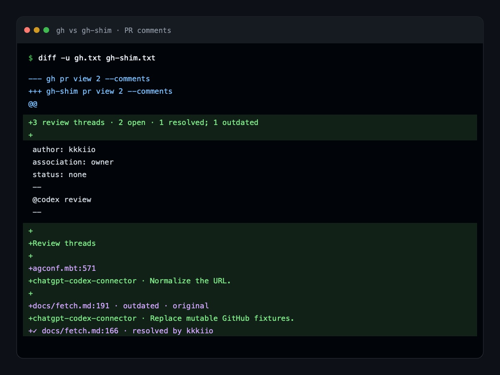

# gh-shim

<p align="center">
  
</p>

`gh-shim` 是 GitHub CLI 的透明增强层：它保留日常 `gh` 命令的行为，并让 `gh pr view --comments` 同时呈现 Conversation、review summary 和完整的 inline review threads，避免开发者与 Coding Agent 漏掉代码行上的反馈。



## Why gh-shim

GitHub CLI 是开发者和 Coding Agent 使用 GitHub 的通用入口，但 GitHub API 已提供的部分信息，在 `gh` 的常用命令中仍然缺失或不够直观。PR review comments 是其中最容易造成误判的场景：

```bash
gh pr view <pr> --comments
```

这条命令会显示 PR Conversation 中的普通评论和 review summary，却不会完整显示附着在文件与代码行上的 inline review threads。命令仍会成功并返回看似合理的结果，因此人和 Agent 都可能据此错误地判断“这个 PR 没有待处理的 review feedback”。相比明确失败，这种静默遗漏更难发现。

这个问题长期出现在 GitHub CLI 的用户反馈中：

- [cli/cli#359：Fine Grained Code Review Support](https://github.com/cli/cli/issues/359)
- [cli/cli#3883：pr review comments do not show up with `gh pr view -c`](https://github.com/cli/cli/issues/3883)
- [cli/cli#5788：`gh pr view --comments` should show all comments](https://github.com/cli/cli/issues/5788)
- [cli/cli#11477：`gh pr view --json comments` does not include review comments](https://github.com/cli/cli/issues/11477)

`gh-shim` 利用 GitHub API 补齐这类信息差，同时保留用户和 Agent 已经熟悉的 `gh` 命令入口。它是官方 CLI 的增强层，不是另一个 GitHub 客户端。

## Goals

- 让现有 `gh` 调用返回用户合理预期的完整信息，无需为每个缺口学习额外命令。
- 保留原生 `gh` 的参数、认证、输出和退出状态，只增强经过明确设计的场景。
- 保留 review thread 的位置、回复关系、resolved 和 outdated 状态，而不是把不同类型的评论混成扁平列表。
- 无法取得完整数据时明确失败，避免把不完整结果伪装成成功。

## Installation

需要 MoonBit、已安装并登录的 GitHub CLI；使用 `--jq` 时还需要 PATH 中存在 `jq`。通过 Moon 安装：

```bash
moon install KKKIIO/gh-shim/cmd/gh-shim
~/.moon/bin/gh-shim init
exec "$SHELL"
```

`gh-shim init` 会创建专用 `gh` launcher，并在当前 shell 的启动文件中加入一条可重复执行的激活配置。它不会覆盖真实的 `gh`。

## Usage

继续使用原有的 `gh` 命令即可：

```bash
gh pr view 42 --comments --repo owner/repository
```

首行会给出 review thread 状态摘要，随后保留原生输出，并按 unresolved、outdated、resolved 状态分组展示 inline threads。JSON 调用会在请求 `comments` 时补充 `reviewThreads`：

```bash
gh pr view 42 --repo owner/repository --json comments \
  --jq '{comments: (.comments | length), reviewThreads: (.reviewThreads | length)}'
```

包含 `comments` 或 `reviewThreads` 的增强 JSON 输出支持原始 JSON 和 `--jq`，不接受 `--template`；其他原生字段投影仍由 GitHub CLI 处理。

检查 PATH 接管状态与真实 GitHub CLI 路径：

```bash
gh-shim doctor
```

## Project lifecycle

`gh-shim` 有意保持为一个过渡性的增强层。如果官方 GitHub CLI 将来能够在文本和 JSON 输出中完整提供 review comments 及其 thread 语义，`gh-shim` 会移除对应增强并升级为纯转发，避免重复或改写官方结果。

如果届时没有其他 `gh` 命令需要增强，本项目会归档，并建议所有用户直接使用官方 GitHub CLI。项目的成功标准不是永久取代 `gh`，而是让这个信息缺口最终消失。

## Related work

[`agynio/gh-pr-review`](https://github.com/agynio/gh-pr-review) 是专门处理 inline PR review 的 GitHub CLI extension，支持查看、回复和解决 review threads，并面向自动化 review Agent 提供结构化输出。它适合主动采用专用 review 工作流的用户；`gh-shim` 则选择保留既有 `gh pr view --comments` 调用，让尚未意识到信息缺口的人和 Agent 也能得到完整反馈。

输出结构和 shell 激活方式的完整决策分别记录在 [ADR 0001](docs/adr/0001-enhance-gh-pr-view-comments.md) 与 [ADR 0002](docs/adr/0002-install-and-activate-the-shim.md)。
